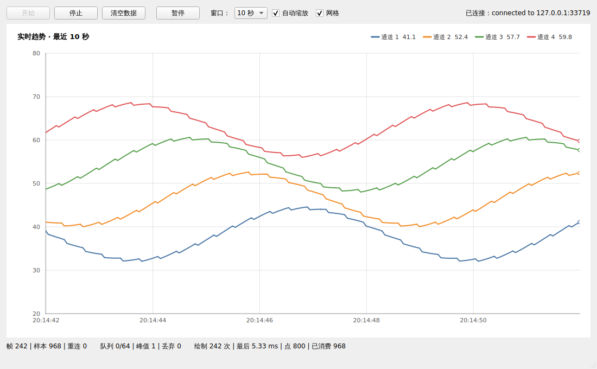

# Lab 08：QPainter 实时趋势图

## 需求

1. GUI 工程 `lab08_trendchart`；复用 05/06/07 的协议、队列、worker 和 mock server。
2. `ChartWidget : QWidget`：
   - `appendSamples()` 只追加数据并 `update()`，不直接绘制；
   - 每通道一个固定容量环形缓冲，忽略 NaN/Inf；
   - 横轴滑动窗口（5/10/30/60 秒），右边界跟最新样本，左边界 = 右边界 − 窗口；
   - 暂停冻结右边界但继续收数据，恢复后跳到最新；
   - 所有绘制在 `paintEvent()`：背景、标题、绘图区、网格、刻度、曲线、图例、暂停徽标；曲线裁剪在绘图区内；
   - Y 轴用 1/2/5 × 10ⁿ 的 nice step，约 5 格；X 轴时间刻度对齐整步长，标签 `HH:mm:ss`；
   - 自动缩放按可见数据加 padding；窗口内无数据时保留上一范围；可切固定 0～100；
   - 每通道一条 `drawPolyline()`，抗锯齿，画最新点标记；图例显示通道名和最新值；
   - 点数超过绘图区像素宽度时，按像素列保留 first/min/max/last 四点再连线；
   - 复用坐标缓冲，不在 `paintEvent()` 里分配大容器；
   - 暴露累计重绘次数、最近一次绘制耗时、可见点数。
3. `MainWindow`：
   - 复用 07 的 worker 和队列，40ms 定时 `takeAll()` 后一次 `appendSamples()`；
   - 控件：开始/停止/清空、暂停、时间窗口、自动缩放、网格；
   - 状态显示连接、帧/样本/重连、队列、绘制指标；
   - 生命周期沿用 07；暂停状态下点“开始”自动恢复。
4. 数据源：默认内嵌 mock server，50ms 一帧、每帧 4 个样本；4 通道用不同基线/相位的正弦波（基线约 38/46/54/62，幅度 6，加少量抖动）。
5. 命令行：默认内嵌 mock；`--host/--port`；`--auto-seconds N`；`--screenshot PATH` 退出前保存窗口 PNG。

## 验收

- [ ] 4 条曲线持续从右向左滚动，最新点在右边缘；
- [ ] 所有绘制在 `paintEvent()`，曲线不覆盖坐标轴和图例；
- [ ] Y 轴刻度为整齐的 1/2/5 × 10ⁿ 倍数，X 轴刻度不重叠；
- [ ] 自动缩放能包住可见数据，无数据时不闪跳；固定 0～100 可切换；
- [ ] 5/10/30/60 秒窗口切换立即生效；
- [ ] 暂停冻结并显示徽标，后台继续接收，继续后跳到最新；
- [ ] 点数超过宽度时使用 min/max 降采样，尖峰不被抹掉；
- [ ] 状态栏显示重绘次数、耗时、可见点数；
- [ ] 连续启动/停止 5 次无崩溃，关窗无 QThread 警告，0 warning。

参考实现见本目录。