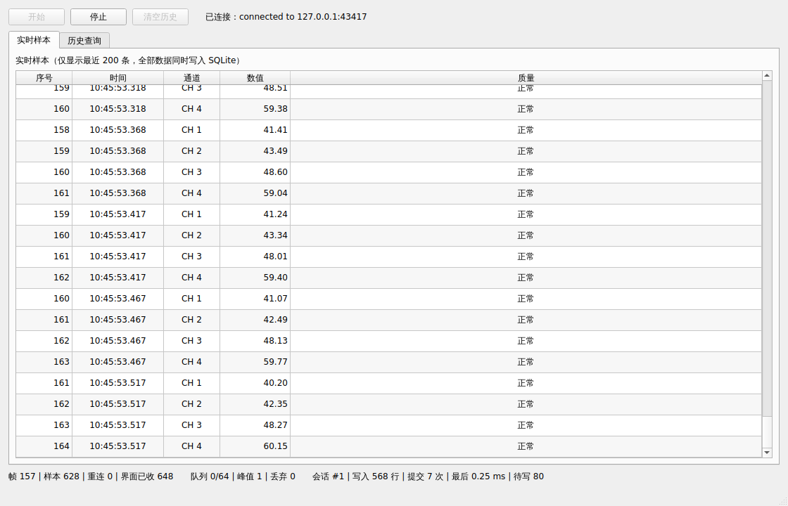
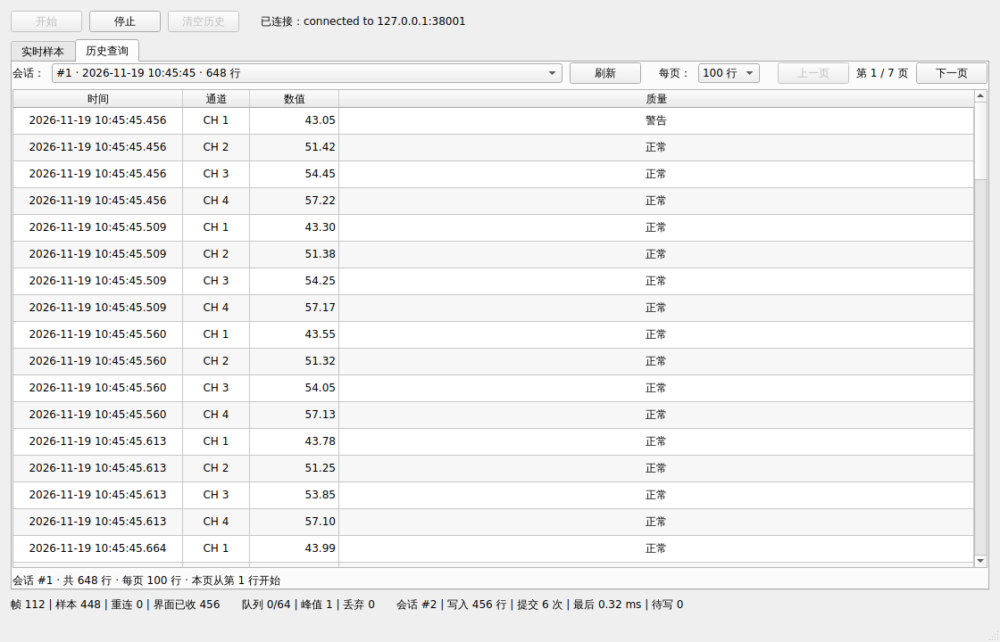

# Lab 09：SQLite 遥测持久化

## 需求

1. GUI 工程 `lab09_storage`，依赖 `Qt6::Core`、`Qt6::Network`、`Qt6::Sql`、`Qt6::Widgets`；复用 05/06/07 的网络链路。
2. Schema：
   - 会话表：自增 id、标签、开始/结束时间（Unix 毫秒，结束可为空）、样本数；
   - 样本表：自增 id、外键 `session_id`（级联删除）、`ts_ms`、通道、数值、质量；
   - 复合索引 `(session_id, ts_ms, id)`，分页查询必须走索引；
   - 用 `PRAGMA user_version` 记录版本；建表幂等；每个连接启用外键。
3. `DbWriter`（DB 线程，`moveToThread`）：
   - `open()` 槽在 DB 线程内 `addDatabase()`；设置 WAL、`synchronous=NORMAL`、`busy_timeout=5000`、外键；
   - 预编译 INSERT；每 500 行或约 1 秒提交一批，每批一个事务，失败整批回滚；
   - 结束会话前先 flush，再写 `ended_ms` 和 `sample_count`；
   - `shutdown()` 在 DB 线程内 flush、结束会话、关闭连接、`removeDatabase()`、退出线程；
   - 启动时修复 `ended_ms IS NULL` 的会话：结束时间取最后样本时间（无样本取开始时间），样本数按真实 COUNT 重算。
4. GUI：
   - 实时页：模型只保留最近 200 条，insert/remove 更新；GUI 每 40ms `takeAll()`，追加实时模型并把同一批发给 writer；
   - 历史页：GUI 线程独立只读连接；会话下拉按 id 倒序；分页 50/100/200/500，上一页/下一页，显示页码和总行数；按 `(ts_ms, id)` 稳定排序；
   - 开始/停止/清空历史；DB 就绪前不能开始；一次运行只允许一个会话；
   - 停止顺序：停 worker → 排空队列 → 最后一批发 writer → `endSession()`；
   - 关窗：停 worker → 排空 → endSession → shutdown DB → 等线程结束；
   - 状态栏显示连接、帧/样本、队列、会话 id、写入行数、提交次数和最近耗时。
5. 数据源沿用单元 08 的内嵌 mock server。

## 验收

- [ ] 写连接只在 DB 线程创建和使用，GUI 读连接独立且名称不同；
- [ ] 写入用事务 + 预编译语句，提交次数明显少于写入行数；
- [ ] 实时表只保留 200 行；DB 中保留全部；
- [ ] 停止后 `ended_ms` 非空，`sample_count` 与实际样本行数一致；
- [ ] 实时已收、DB 写入、`samples` 表行数三者一致；
- [ ] 历史分页总数/页数正确，同毫秒翻页不重不漏；
- [ ] `EXPLAIN QUERY PLAN` 走复合索引，无临时排序；
- [ ] 重启后旧会话仍在；强杀后已提交数据保留，启动能修复未结束会话；
- [ ] 关窗无 `connection is still in use` 或 QThread 警告；0 warning。

参考实现见本目录。