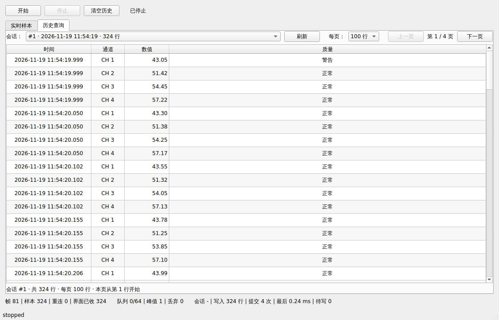

# Lab 09：SQLite 遥测持久化

> **配套知识**：[单元 09 - SQLite 持久化](../../09-SQLite持久化.md)
> **工程位置**：`D:\Qt_\learn_demo\lab09_storage\`（Windows，用 Qt Creator 打开）
> **参考实现**：工程内的 `.cpp/.h` 和 `CMakeLists.txt`。先按本文档自己写，写完再对照。

---

## 目标

把单元 07/08 已经送到 GUI 的遥测样本真正落盘，并支持历史查询：

- 独立 DB 线程 + 独立写连接，GUI 线程不执行任何写 SQL；
- WAL + 事务 + 预编译语句批量写入，而不是逐行自动提交；
- 每次“开始采集”对应一个会话，停止时写结束时间和样本数；
- 历史页用独立读连接和 `LIMIT/OFFSET` 分页查询，支持切换会话与页大小；
- 停止、关窗、强杀进程三种情况下都能解释数据是否保留；
- 启动时修复上次异常退出遗留的“未结束会话”。

本 Lab 的核心是**连接、线程、事务、分页**；网络链路直接复用单元 07/08，不修改协议。

## 前置

- 单元 04：模型/视图批量更新，理解 `beginInsertRows/endInsertRows`；
- 单元 07：`TelemetryWorker`、`BoundedBatchQueue`、GUI 定时 `takeAll()` 的完整链路；
- 单元 08：同一批样本已经在 GUI 中消费，知道“每批只做一次界面更新”；
- 单元 05/06：协议、CRC、`StreamDecoder` 可用，不要修改线上格式。

## 需求

### 1. 工程

- 工程名 `lab09_storage`，GUI 程序；
- 依赖 `Qt6::Core`、`Qt6::Network`、`Qt6::Sql`、`Qt6::Widgets`；
- 保留控制台输出（mock/worker/db 日志），CMake 中设置 `WIN32_EXECUTABLE FALSE`；
- C++20，MSVC 下带 `/utf-8`；
- 构建 **0 warning**；
- 复用单元 05/06/07 的 `protocol.*`、`crc32.*`、`streamdecoder.*`、`telemetrytypes.h`、`boundedqueue.*`、`telemetryworker.*`、`mocktelemetryserver.*`；
- 新增数据库相关文件，例如 schema 辅助、writer、历史面板、实时模型，可按自己的命名拆分。

### 2. 数据库 schema

自己设计并实现建表，至少包含：

**会话表**

- 自增主键 `id`；
- 标签/开始时间（Unix 毫秒整数）；
- 结束时间，允许为空，表示会话未结束；
- 样本数缓存字段。

**样本表**

- 自增主键；
- 外键 `session_id`，删除会话时级联删除样本；
- 服务端时间戳（Unix 毫秒整数，不使用本地时间字符串）；
- 通道号、浮点值、质量枚举（整数）。

**其它要求**

- 在 `(session_id, ts_ms, id)` 上建复合索引，分页查询必须走索引，不能出现全表扫描 + 临时排序；
- 按时间清理未来数据需要 `ts_ms` 索引；
- 使用 `PRAGMA user_version` 记录 schema 版本；
- 建表必须幂等，重复启动不报错；
- 每个连接都启用外键（SQLite 默认关闭）。

### 3. DbWriter（本 Lab 的核心）

一个 `QObject`，通过 `moveToThread()` 运行在独立 DB 线程：

- **连接创建在 DB 线程**：`open()` 槽由线程 `started` 信号触发，在槽内 `addDatabase()`；
- 打开后设置：`journal_mode=WAL`、`synchronous=NORMAL`、`busy_timeout=5000`、`foreign_keys=ON`；
- 预编译一条 `INSERT`，批次内复用，不拼接 SQL；
- 提供槽：开始会话、追加样本、flush、结束会话、清空历史、shutdown；
- 写入策略：
  - 缓冲达到约 500 行，或距上次提交约 1 秒，提交一批；
  - 每批一个事务；任何一行失败整批回滚；
  - 结束时先 flush，再写 `ended_ms` 和 `sample_count`；
- 统计信号：累计写入行数、提交次数、最近一次提交耗时、当前待写行数；
- `clearAll()` 只允许在没有活动会话时执行；
- `shutdown()` 在 DB 线程内：停定时器、flush、结束会话、销毁查询、关闭连接、`removeDatabase()`、`quit()` 线程；
- 销毁顺序必须正确，不能出现 `connection ... is still in use` 警告；
- 启动时把所有 `ended_ms IS NULL` 的会话修复为已结束：
  - 结束时间取该会话最后一个样本的时间，没有样本则取开始时间；
  - `sample_count` 用真实 `COUNT(*)` 重算。

### 4. GUI

主窗口包含两个标签页：

**实时样本**

- 表格模型只保留最近 200 条，展示序号、时间、通道、数值、质量；
- 新数据追加时用 `beginInsertRows/endInsertRows`，超出容量时删除最旧行；
- 完整数据不驻留内存，旧行丢弃后仍可从数据库查询；
- 数据来源与单元 08 相同：worker 入队，GUI 每 40 ms `takeAll()`；
- GUI 展开批次后：
  - 追加到实时模型；
  - 若会话进行中，通过队列连接把同一批发给 DbWriter。

**历史查询**

- 使用 **GUI 线程自己的只读用途连接**，不借用 writer 连接；
- 会话下拉框按 id 倒序列出；已结束显示样本数，进行中显示“采集中”；
- 选择会话后分页显示时间、通道、数值、质量；
- 页大小 50/100/200/500 可选；上一页/下一页；显示“第 N / M 页”和总行数；
- 空会话、空数据库、查询失败都要有明确文字；
- 刷新按钮重新加载会话和当前页；切换到历史页时自动刷新；
- 分页查询按 `(ts_ms, id)` 稳定排序，`(ts_ms, id)` 的第二键不能省；
- 模型必须比读连接活得久，析构顺序正确。

**控制与生命周期**

- 开始 / 停止 / 清空历史；
- 数据库就绪前不能开始；
- 开始后自动创建会话并启动 worker；一次运行只允许一个会话；
- 停止流程：
  1. 停 worker；
  2. GUI 最后排空队列；
  3. 把最后一批发给 writer；
  4. `endSession()`；
  5. 恢复按钮状态；
- 清空历史仅在停止后可用；
- 关窗时：停 worker → 最终排空 → endSession → shutdown DB → 等待线程结束；
- 状态栏显示：连接状态、帧/样本/重连、队列深度/峰值/丢弃、界面已收、会话 id、写入行数、提交次数、最近提交耗时、待写行数。

### 5. 数据源

- 默认在主线程创建 `MockTelemetryServer`，监听 `127.0.0.1`，端口 0 由系统分配；
- 每个客户端 50 ms 发一帧（20 Hz），每帧 4 个样本，通道 1..4 各一个；
- 复用单元 08 的 4 通道正弦波数据，不改协议；
- 允许 `--host/--port` 连接外部服务端。

### 6. 命令行

参考实现提供：

- 默认：GUI + 内嵌 mock server + 自动开始采集；
- `--db PATH`：数据库文件路径，默认当前目录 `lab09_telemetry.sqlite`；
- `--host H --port P`：连接外部服务端；
- `--auto-seconds N`：运行 N 秒后自动关窗；
- `--stop-after-seconds N`：运行 N 秒后自动停止采集（等价于点“停止”），但不关窗，便于验证会话收尾；
- `--screenshot PATH`：退出前保存窗口 PNG（未设置 `--auto-seconds` 时默认运行 5 秒）；
- `--history`：启动约 1.5 秒后切到历史页，便于无头截图。

`--auto-seconds` / `--stop-after-seconds` / `--history` / `--screenshot` 不是课程重点，但能让无头环境验证“停止时最后一批不丢、会话正确结束、分页正常”，建议保留。

## 步骤

1. 建工程，复制单元 05/06/07 的协议、CRC、解包器、队列、worker、mock server；
2. 先写 schema 辅助函数：打开连接、pragma、建表、`user_version`、错误格式化；
3. 写 `DbWriter` 骨架：DB 线程 + `open()` + 信号；先只建表，不写数据；
4. 加会话表插入，开始/结束会话，验证数据库里出现会话行；
5. 加样本缓冲和批量事务写入，先在 `endSession` 时一次性 flush，确认行数正确；
6. 加 1 秒定时 flush 和 500 行阈值，观察提交次数与待写行数；
7. 接 GUI 实时表：先本地模型，再把每批转发给 writer；
8. 写历史面板：读连接、会话下拉、`COUNT(*)`、`LIMIT/OFFSET`、页码按钮；
9. 接生命周期：开始/停止/关窗，确保最后一批不丢、会话有结束时间；
10. 加强杀恢复：启动时修复未结束会话；
11. 加清空历史，确认只能在停止后执行；
12. 用 `--auto-seconds` 跑一次，检查数据库行数、会话数、分页页数，再做验收清单。

## 运行后应该看到

**实时页**（运行约 8 秒）：


**历史页**（第二次启动，正在采集第 2 个会话，浏览第 1 个会话）：


界面上：

- 启动后自动连接内嵌 mock server，开始采集；
- 实时页每秒约 80 行新数据，表格只保留最近 200 条，自动滚到底部；
- 状态栏显示会话号、累计写入行数、提交次数、最近一次提交耗时、待写行数；
- 待写行数会在 0～80 之间变化：达到 1 秒或 500 行时归零；
- 切到“历史查询”，会话下拉按时间倒序；已完成会话显示行数，正在采集的显示“采集中”；
- 选择会话后显示第 1 页 100 行，底部显示“会话 #N · 共 X 行 · 每页 100 行”；
- 时间列精确到毫秒，同一帧的 4 个通道时间相同；
- 上一页/下一页、页大小切换、刷新按钮都生效；
- 点“停止”：worker 停止，最后一批写入，会话结束，历史页出现结束时间对应的样本数；
- 再点“开始”：产生新会话，旧会话数据仍在；
- 关闭程序后重新打开，历史页能看到之前的会话；
- 停止状态下“清空历史”可用，执行后会话列表为空；再次开始从 #1 会话开始。

停止后的历史页（开始按钮恢复、清空历史可用、会话显示“324 行”、待写为 0）：



控制台输出（数值随运行时长变化）：

```text
[mock] mock server listening on 127.0.0.1:53556
[db] database opened: /tmp/lab09_demo.sqlite (WAL, synchronous=NORMAL)
[history] history reader opened: /tmp/lab09_demo.sqlite
[gui] database ready: /tmp/lab09_demo.sqlite
[gui] session #1 started at 10:45:59
[db] session 1 started (2026-11-19 10:45:59)
[worker] worker started, connecting to 127.0.0.1:53556
[worker] connected, peer=127.0.0.1:53556
[mock] client connected: 127.0.0.1:53557
[gui] screenshot saved: /tmp/lab09_live.png
[gui] shutdown complete: gui_consumed=648 queue_dropped=0 queue_peak=1 db_rows=568 db_commits=7
[worker] worker stopped by request
[gui] session #1 finished, 648 rows
[db] session 1 finished, 648 rows
[db] database closed: rows=648 commits=8
[mock] client disconnected, 0 remaining
```

关窗时 GUI 会阻塞等待 DB 线程收尾，`session finished` 这类队列信号可能在 `shutdown complete` 之后才补打印，顺序不代表写入顺序；以 `database closed: rows=...` 和数据库实际行数为准。

数据库可以用 DB Browser for SQLite，或命令行工具验证：

```text
sqlite3 lab09_telemetry.sqlite "select id, ended_ms is not null, sample_count from sessions;"
sqlite3 lab09_telemetry.sqlite "select session_id, count(*) from samples group by session_id;"
sqlite3 lab09_telemetry.sqlite "pragma journal_mode;"
sqlite3 lab09_telemetry.sqlite "pragma user_version;"
sqlite3 lab09_telemetry.sqlite "explain query plan select * from samples where session_id=1 order by ts_ms,id limit 100 offset 0;"
```

最后一条应显示使用 `idx_samples_session_time` 的 `SEARCH`，而不是 `SCAN` + 临时排序。

## 可选实验（建议至少做两个）

**实验 A：事务 vs 自动提交**

临时把提交阈值改成“每行一批”（或每批直接提交），运行同样时长，记录提交次数、`-wal` 大小、界面是否卡顿、磁盘写入量。恢复批量提交后再对比。思考：慢的是 SQL 还是 fsync？

**实验 B：批大小**

把 500 行/1 秒改成 2000 行/5 秒，运行 60 秒。比较提交次数、单次提交耗时、崩溃时最多丢多少数据、WAL 峰值。再改成 100 行/200 ms，比较事务碎片化。找出你机器上的平衡点。

**实验 C：keyset 分页**

把历史页的“下一页”改成 keyset：记住上一页最后一行的 `(ts_ms, id)`，用 `ts_ms > ? OR (ts_ms = ? AND id > ?)` 查询。对比第 1 页和第 100 页的耗时（可以先灌入几十万行测试数据）。说明为什么 keyset 不能直接跳到第 N 页。

**实验 D：WAL 并发**

采集过程中：在历史页反复刷新；用另一个进程/SQLite 工具对同一个库执行 `SELECT COUNT(*)`；观察界面是否阻塞、是否出现 `database is locked`、`-wal` 文件大小如何变化。再临时关闭 WAL 对比。

**实验 E：强杀恢复**

采集约 7 秒后强杀进程（Windows 任务管理器“结束任务”，Linux `kill -9`），检查：

- 主文件与 `-wal` 文件大小；
- 数据库里已提交的行数（约为整秒倍数，最多丢最后 1 秒）；
- 会话的 `ended_ms` 是否为 NULL；
- 重新启动后会话是否被修复、总行数是否一致。

再对比 `synchronous=FULL` 的提交耗时（不必真的测断电）。

**实验 F：保留策略**

写一个“删除 7 天前数据”的操作：按 `ts_ms` 分批删除，记录每批耗时；观察删除后文件大小是否变化，再执行 `VACUUM`（或 `PRAGMA incremental_vacuum`）对比。说明为什么不能在一个事务里删掉所有旧数据。

**实验 G：导出 CSV**

从数据库流式导出某个会话的样本到 CSV：`setForwardOnly(true)`，逐行 `next()` 写文件，不要把百万行一次性读进内存。注意 CSV 转义和编码。

**实验 H：只读连接**

用 `setConnectOptions("QSQLITE_OPEN_READONLY")` 打开历史页连接，确认查询正常、写入被拒绝。思考：只读连接能避免哪些误操作？为什么它不能替代“线程内创建连接”的规则？

## 验收清单

- [ ] 构建成功，0 warning；
- [ ] 工程链接了 `Qt6::Sql`，启动时能列出 `QSQLITE` 驱动；
- [ ] 数据库文件、`-wal`、`-shm` 按预期出现；
- [ ] 写连接在 DB 线程创建和使用，GUI 线程不执行写 SQL；
- [ ] GUI 读连接与写连接名称不同、线程不同；
- [ ] 写入使用事务 + 预编译语句，不是逐行自动提交；
- [ ] 提交次数明显少于写入行数（约每秒一次，不是每 40 ms 一次）；
- [ ] 实时表只保留最近 200 行，旧行仍能从数据库查到；
- [ ] 会话表记录了开始/结束时间和样本数；
- [ ] 停止后 `ended_ms` 不为空，`sample_count` 与实际样本行数一致；
- [ ] 实时表已收样本数、DB 写入行数、`samples` 表行数三者一致；
- [ ] 历史页能按会话查询，总行数/页数正确；
- [ ] 每页 100 行时，最后一页行数正确（不是固定 100）；
- [ ] 同一毫秒的样本翻页不重复、不漏行；
- [ ] `EXPLAIN QUERY PLAN` 显示走复合索引，无临时排序；
- [ ] 页大小 50/100/200/500 切换正常；
- [ ] 切换会话后页码重置，翻页按钮边界正确；
- [ ] 停止后“清空历史”可用；执行后会话和样本都为空；采集中该按钮禁用；
- [ ] 连续开始/停止至少 3 次，无崩溃、无挂起、无 QThread 警告；
- [ ] 关闭窗口时先停 worker、排空队列、flush、结束会话、关闭连接，无 `connection is still in use`；
- [ ] 重启程序后能看到之前的会话和数据；
- [ ] 强杀进程后已提交数据保留、完整性检查通过，重启能修复未结束会话；
- [ ] 能解释“为什么 GUI 线程不能直接写 SQL”；
- [ ] 能解释“为什么每次 INSERT 都自动提交会很慢”。

## 思考

1. `QSqlDatabase`、`QSqlQuery` 和 `QSQLITE` 驱动各负责什么？谁创建连接、谁使用连接、谁关闭连接？
2. 为什么连接不能跨线程？Qt 会阻止你吗？违反后可能出现哪些现象？
3. 为什么把数据库操作放在独立的 DB 线程，而不是网络 worker 线程？两种方案各自会让什么变慢？
4. WAL 提供了什么并发能力？为什么仍然只有一个写者？读者看到的是最新数据吗？
5. `busy_timeout` 解决什么问题？它不能解决什么问题？
6. 为什么时间戳存整数毫秒，而不是格式化字符串？两者在排序、时区、夏令时上有什么差别？
7. 复合索引为什么把 `id` 放在最后一列？如果只按 `ts_ms` 排序，分页会出什么问题？
8. 逐行提交慢在哪里？事务批量和预编译语句分别优化了哪一部分？
9. 提交批大小怎么选？太大和太小分别有什么风险？
10. `synchronous=NORMAL` + WAL 下，进程崩溃和断电分别会丢什么？数据库会损坏吗？
11. 为什么停止时要“先排空队列，再 endSession，最后 shutdown”？顺序交换会怎样？
12. 崩溃后为什么会话的 `ended_ms` 是 NULL？启动修复时为什么用 `MAX(ts_ms)` 而不是当前时间？
13. `LIMIT/OFFSET` 在深页为什么慢？keyset 分页需要什么前提？为什么它不能直接跳到第 100 页？
14. 每次翻页都 `COUNT(*)` 有什么代价？已结束会话可以怎么优化？
15. 为什么 `QSqlQueryModel` 的连接必须比模型活得久？销毁顺序错了会看到什么警告？
16. Qt 6.4 中 `setQuery` 为什么建议传右值？复制 `QSqlQuery` 会共享什么？
17. 如果要求 1000 Hz × 8 通道连续采集 24 小时，这个 schema、批量策略和保留策略要怎么调整？
18. 如果允许多个客户端实例同时写同一个数据库，现有设计哪些地方会出问题？你会怎么改？

---

## 模块关系

```text
main.cpp
  ├── 默认 → 主线程创建 MockTelemetryServer（20 Hz，4 通道）
  ├── --host/--port → 连接外部服务端
  ├── --db → 数据库文件路径
  └── --auto-seconds / --screenshot / --history → 无头验证与截图
        └── MainWindow
              ├── 控制栏：开始/停止/清空历史
              ├── 实时页
              │     ├── LiveSampleModel（最近 200 条）
              │     └── QTableView
              ├── 历史页 HistoryPanel（GUI 线程）
              │     ├── 读连接 lab09_reader（QSQLITE）
              │     ├── HistoryQueryModel（QSqlQueryModel 派生）
              │     ├── 会话下拉 + 页大小 + 上一页/下一页
              │     └── SELECT ... LIMIT ? OFFSET ?
              ├── GUI 定时器 40 ms
              │     └── queue.takeAll()
              │           ├── → 实时模型
              │           └── → persistSamples 信号（队列连接）
              ├── QThread（telemetry-worker）
              │     └── TelemetryWorker（moveToThread）
              │           ├── QTcpSocket / StreamDecoder / 重连
              │           └── queue.push(TelemetryBatch)
              └── QThread（db-writer）
                    └── DbWriter（moveToThread）
                          ├── 写连接 lab09_writer（QSQLITE, WAL）
                          ├── 预编译 INSERT + 事务批量
                          ├── 会话开始/结束、崩溃遗留会话修复
                          └── stats/error/log 信号

共享：protocol.* / crc32.* / streamdecoder.* / telemetrytypes.h（来自 05、06）
      boundedqueue.* / telemetryworker.* / mocktelemetryserver.*（来自 07、08）
```

关键点：

- 线程边界只有三处：`queue.push/takeAll`、GUI→writer 的队列信号、writer→GUI 的信号；
- 连接边界：`lab09_reader` 只在 GUI 线程，`lab09_writer` 只在 DB 线程；
- 数据边界：界面只保留最近 200 条，数据库保留全部；
- 顺序边界：开始会话先于第一批样本，最后一批先于 `endSession`，`endSession` 先于 `shutdown`。

## 参考实现说明

工程内含：

- `main.cpp`、`mainwindow.h/.cpp`；
- `dbwriter.h/.cpp`（核心：连接、批量写、会话、恢复、关闭）；
- `databaseschema.h/.cpp`（路径、pragma、建表、版本、错误格式化）；
- `livemodel.h/.cpp`（最近 200 条的实时表模型）；
- `historypanel.h/.cpp`（读连接、会话列表、分页、查询模型）；
- 复用：`boundedqueue.*`、`telemetryworker.*`、`mocktelemetryserver.*`、`streamdecoder.*`、`protocol.*`、`crc32.*`、`telemetrytypes.h`。

参考实现已在 Linux Qt 6.4.2 + GCC（`-Wall -Wextra`，0 warning）下构建通过，并用 offscreen 平台验证：

- 8 秒运行：GUI 消费 648 个样本，队列丢弃 0、峰值 1；数据库最终 648 行，约每秒提交一次，单次提交约 0.25～0.36 ms；
- 第二次启动同一数据库：新会话继续写入，旧会话数据完整保留；历史页显示第 1 个会话 648 行、7 页，第 1 页 100 行；
- 停止路径：`--stop-after-seconds 4` + `--auto-seconds 9`，第 4 秒停止采集后窗口继续运行到第 9 秒；会话写入 `ended_ms`，`sample_count=324` 与 `samples` 表 324 行一致，之后待写保持 0，开始/清空按钮恢复可用；
- 强杀测试：采集约 7 秒后 `kill -9`，数据库留下 484 条已提交样本，`-wal` 约 230 KB，`PRAGMA integrity_check` 为 `ok`；重启后旧会话被修复、数据保留，新会话正常写入；
- 关窗流程在超时内完成，没有 `connection is still in use` 或 QThread 警告。

不同机器/平台的磁盘与 fsync 耗时差异很大；验收只要求“批量提交明显快于逐行、界面流畅、停止不丢最后一批”，不要求和参考数字一致。Windows 上请用 Qt Creator 自行按验收清单跑一遍。

建议顺序：先自己写完并过验收清单，再打开对照。重点看：

- `DbWriter::open()` 如何把连接限制在 DB 线程；
- `appendSamples()` → `writePending()` 的缓冲与事务；
- `endSession()` 与 `shutdown()` 的顺序；
- `configureWriter()` 里的 pragma、schema 和崩溃会话修复；
- `HistoryPanel::refreshPage()` 的排序、分页和模型绑定；
- `MainWindow::onThreadFinished()` / `shutdownAll()` 如何保证最后一批不丢。

## 完成后

按 [README](../../README.md) 的规则回复“**单元 9 完成**”，并附上：

```text
单元 9 完成
- 构建是否 0 warning：
- DB writer 是否在独立线程：
- 停止后实时已收/DB 写入/samples 表三处行数是否一致：
- 历史页分页、会话切换、页大小是否正常：
- 重启后旧会话是否还在：
- 强杀进程后数据保留与启动修复是否验证：
- 单次批量提交耗时：
- 自测题有没有不会的：
```