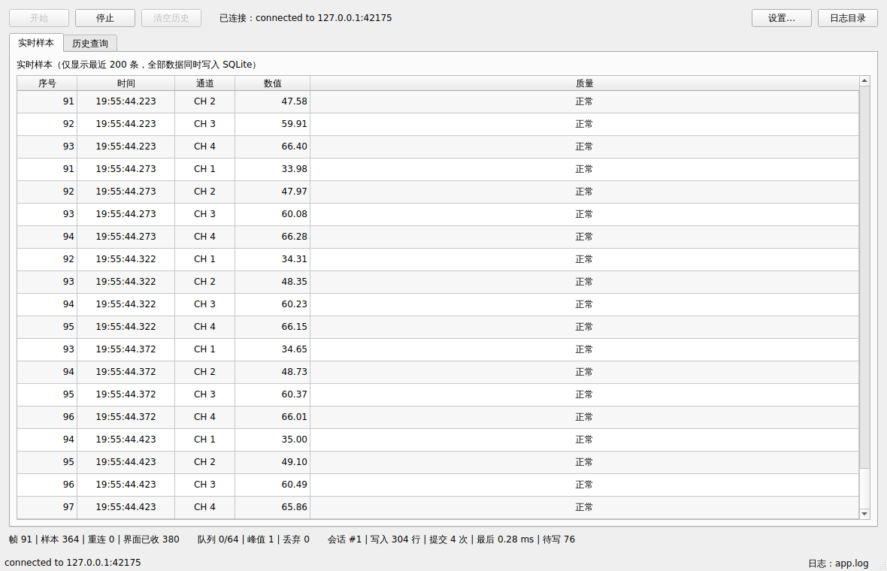

# Lab 10：文件、配置、CSV 与日志

## 需求

1. GUI 工程 `lab10_files`，依赖 Core/Network/Sql/Widgets；复用 09 的网络和数据库模块。
2. 路径：
   - 在 `QApplication` 之后设置组织名/应用名，再用 `QStandardPaths` 解析数据、配置、日志、导出目录；
   - 空路径要有回退；启动时 `mkpath` 并检查失败；
   - `--data-dir DIR` 把四类目录收进同一目录；业务代码统一用 `QDir::filePath()`。
3. 配置：
   - `QSettings` INI，保存页大小、日志级别、导出目录、UTF-8 BOM、自动开始、数据库路径、窗口几何/状态；
   - 读取时提供默认值和校验，非法值回退并记 Warning；
   - 数据库路径优先级：`--db` > 配置 > `dataDir/telemetry.sqlite`；
   - 设置对话框包含上述项；保存时规范化路径、创建目录、`sync()` 并检查 `status()`；
   - 页大小、日志级别、导出目录、BOM 立即生效；数据库路径和自动开始重启生效。
4. 日志：
   - 分类 `app`、`db`/`net`、`csv`，自定义 `qInstallMessageHandler` 同时写 stderr 和 `logs/app.log`；
   - 格式含毫秒时间、级别、分类、线程名；低于当前级别丢弃；
   - 互斥量保证多线程不交错；每条 flush；
   - 超过大小或跨天时轮转为 `app-*.log`，只保留最近 N 个；
   - 打开失败退回控制台，不崩溃、不递归打日志；
   - 退出时刷新、关闭文件、恢复原 handler。
5. CSV 导出：
   - 独立线程，线程内创建自己的只读连接；按 `(ts_ms, id)` 排序，先 `COUNT(*)` 取总数；
   - `setForwardOnly(true)` 逐行读，用 `QSaveFile` 写目标文件；
   - 表头 `会话,时间,时间戳(ms),通道,数值,质量`，CRLF；含逗号/引号/换行时加引号并翻倍内部引号；可选 UTF-8 BOM；
   - 进度信号，导出期间界面可操作；`cancel()` 用原子变量，取消后清理临时文件、不覆盖旧文件；
   - 历史页“导出 CSV…”只对选中会话可用，导出中禁用。
6. 生命周期：关窗时先取消并等待导出线程，再停网络、排空队列、结束会话、关闭 DB，最后保存配置并关闭日志。

## 验收

- [ ] 首次启动在标准位置创建 data/config/logs/exports，程序目录没有写入；
- [ ] `--data-dir` 生效；启动日志打印各路径；
- [ ] 配置可手工修改并重启生效，`--db` 优先级正确；设置对话框能保存并提示失败；
- [ ] 控制台和 `app.log` 都有日志，线程名正确；轮转和保留数量正确；
- [ ] 日志目录不可写时应用仍能运行并在控制台报告；
- [ ] CSV 行数 = 表头 + 会话样本数；CRLF、BOM、转义正确，标准解析器能读回一致；
- [ ] 导出使用独立线程和只读连接，不阻塞界面；取消及时且不覆盖旧文件；
- [ ] 关窗无 QThread / `connection ... is still in use` 警告，无临时文件残留；
- [ ] 0 warning。

参考实现见本目录。