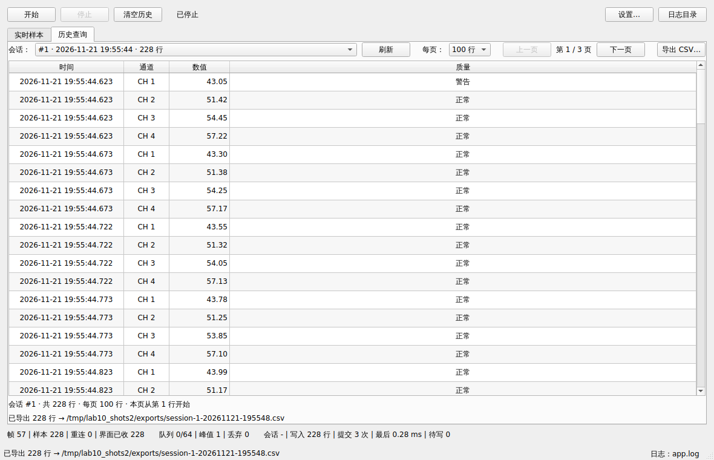

# Lab 10：文件、配置、CSV 与日志

> **配套知识**：[单元 10 - 文件、配置、CSV 与日志](../../10-文件配置CSV与日志.md)
> **工程位置**：`D:\Qt_\learn_demo\lab10_files\`（Windows，用 Qt Creator 打开）
> **参考实现**：工程内的 `.cpp/.h` 和 `CMakeLists.txt`。先按本文档自己写，写完再对照。

---

## 目标

在单元 09 的“网络 → 队列 → SQLite → 历史查询”链路上，补上交付客户端所需的文件能力：

- 用 `QStandardPaths` 决定数据、配置、日志、导出目录，不在程序目录乱写；
- 用 `QSettings` 持久化页大小、日志级别、导出目录、数据库路径、自动开始和窗口状态；
- 启动时初始化文件日志，按级别和分类输出，支持按大小/日期轮转和保留数量；
- 用独立线程把历史会话流式导出为 CSV：只读连接、`setForwardOnly`、`QSaveFile`、BOM 可选、转义正确、可取消；
- 关闭窗口时先取消导出、再收尾数据库，最后刷日志，不丢数据、不出现线程/连接警告。

本 Lab 的核心是**路径、配置、文件原子性、日志、CSV、长任务线程**；网络协议、数据库 schema、分页查询沿用单元 05/06/07/09，不修改协议。

## 前置

- 单元 05：UTF-8、`QString`/`QByteArray`、字节与文本的区别；
- 单元 07：worker 线程、队列、停止与等待；
- 单元 09：每线程数据库连接、只读连接、会话与样本表、分页查询；
- 知道 `QFileDialog` 的基本用法（单元 03 已出现）。

## 需求

### 1. 工程

- 工程名 `lab10_files`，GUI 程序；
- 依赖 `Qt6::Core`、`Qt6::Network`、`Qt6::Sql`、`Qt6::Widgets`；
- 保留控制台输出，CMake 设置 `WIN32_EXECUTABLE FALSE`；
- C++20，MSVC 下带 `/utf-8`；
- 构建 **0 warning**；
- 复用单元 05/06/07/09 的协议、解包、队列、worker、mock server、数据库 writer、schema、实时/历史面板；
- 新增模块建议：路径、配置、日志、CSV 导出 worker、设置对话框。

### 2. 路径（AppPaths）

- 在 `QApplication` 之后、读取任何路径之前设置组织名和应用名（例如 `QtLearn` / `lab10_files`）；
- 用 `QStandardPaths::writableLocation()` 解析：
  - 数据目录：`AppDataLocation`，放数据库；
  - 配置目录：`AppConfigLocation`，放 `settings.ini`；
  - 日志目录：数据目录下的 `logs/`；
  - 导出目录：`DocumentsLocation` 下的应用导出目录；空路径要有回退；
- 对返回空字符串的标准路径做兜底，不允许直接使用空路径；
- 启动时 `mkpath` 所有目录并检查失败；
- 提供 `--data-dir DIR`：把 data、config、logs、exports 全部收进该目录（实验/无头验证用）；
- 启动日志打印 data/config/logs/默认导出目录、配置文件名、日志文件、数据库路径；
- 业务代码不得自己拼 `"/"`；统一用 `QDir::filePath()`；
- 程序目录下不应出现数据库、日志、配置（除非显式用 `--data-dir` 指过去）。

### 3. 配置（AppSettings + 设置对话框）

- 用 `QSettings(path, QSettings::IniFormat)`，配置文件放在配置目录；
- 至少保存：
  - `history/pageSize`：50/100/200/500；
  - `log/level`：debug/info/warning/critical；
  - `export/dir`：CSV 默认目录；
  - `export/utf8Bom`：是否写 BOM；
  - `capture/autoStart`：启动后是否自动开始采集；
  - `storage/dbPath`：数据库路径（重启后生效）；
  - `window/geometry`、`window/state`：窗口大小/位置；
- 读取时提供默认值并校验；非法值回退默认并记录 Warning；
- 优先级固定：`--db > storage/dbPath > dataDir/telemetry.sqlite`；
- 设置对话框至少包含：数据库路径（带浏览、说明重启生效）、导出目录、页大小、日志级别、自动开始、CSV BOM；
- 保存时规范化路径、创建导出目录、写入后 `sync()` 并检查 `status()`；失败要提示，不能静默；
- 能立即生效的设置：页大小、日志级别、导出目录、BOM；需要重启的设置：数据库路径、自动开始；
- 启动时恢复窗口几何；关闭时保存；恢复失败/多屏变化时不能让窗口不可见。

### 4. 日志（Logging）

- 定义至少三个分类：`app`、`db`/`net` 可选、`csv`；用 `Q_LOGGING_CATEGORY` / `qCInfo` 输出；
- 安装自定义 `qInstallMessageHandler`：
  - 同时写 stderr 和 `<logDir>/app.log`；
  - 行格式包含本地时间（毫秒）、级别、分类、线程名、消息；
  - GUI 线程显示 `gui`，网络/DB/导出线程显示各自的 `objectName`；
  - 低于当前最低级别的消息丢弃；
- 线程安全：任意线程同时写日志不交错、不崩溃，用互斥量保护文件与轮转状态；
- 文件写入：
  - 启动时创建日志目录，打开追加；
  - 每条 flush（课程优先保证可诊断性）；
  - 超过配置大小或跨天时轮转：当前 `app.log` 重命名为带时间戳的 `app-*.log`，再重新打开 `app.log`；
  - 只保留最近 N 个历史文件，删除最旧的；
  - 日志打开失败时退回控制台，不崩溃、不递归打日志；
- 日志级别可从设置和命令行读取，运行时通过设置对话框切换；
- 打开 debug 时，关闭 Qt 自身的 `qt.*` debug（避免内部日志淹没应用日志）；
- 退出时刷新、关闭文件、恢复原 handler；
- 日志中不得出现密码、令牌等敏感信息。

### 5. CSV 导出（CsvExportWorker）

- 在独立线程导出，线程内创建**自己的只读连接**（`QSQLITE_OPEN_READONLY`），不借用 GUI/DB 线程连接；
- 查询指定会话的所有样本，按 `(ts_ms, id)` 排序；
- 先用 `COUNT(*)` 拿总数用于进度；
- `setForwardOnly(true)`，逐行读取，累积缓冲区再写，不能把全部行读进内存；
- 用 `QSaveFile` 写目标文件：写临时文件，最后 `commit()`；失败/取消时旧文件保持完整；
- CSV 规则：
  - 表头 `会话,时间,时间戳(ms),通道,数值,质量`；
  - CRLF 行尾；
  - 字段含逗号、双引号、换行时加引号，内部双引号翻倍；
  - 数值固定小数位，用 `.`；
  - 可选 UTF-8 BOM（默认开，方便 Excel 显示中文）；
  - 时间同时写格式化和整数毫秒；
- 进度信号：已读行数/总行数；GUI 显示进度；大文件导出期间界面必须可操作；
- 取消：GUI 直接调用线程安全的 `cancel()`（原子变量），循环定期检查；取消后删除临时文件、不覆盖旧文件、状态显示“已取消”；
- 默认文件名带会话号和时间戳，放在配置的导出目录；用户可通过文件对话框改路径；
- 历史页提供“导出 CSV…”按钮，只对选中会话可用；导出中禁用按钮；
- 导出完成后在历史页和状态栏显示“已导出 N 行 → 路径”；失败显示原因；
- 关闭窗口时若导出仍在进行：先取消、等待导出线程结束，再停网络/数据库。

### 6. GUI 与生命周期

- 主窗口保留单元 09 的实时页、历史页、开始/停止/清空、状态栏统计；
- 顶部增加“设置…”“日志目录”按钮；状态栏右侧显示当前日志文件名（悬停显示完整路径）；
- 历史页增加“导出 CSV…”按钮和一行导出状态；
- 启动自动开始受配置控制；关闭后重新启动能读到页大小、日志级别、导出目录、BOM、窗口状态；
- “清空历史”在采集/导出进行中禁用；
- 关闭流程：
  1. 取消并等待 CSV 导出线程；
  2. 停网络 worker，最终排空队列；
  3. 结束会话、flush DB、关闭连接；
  4. 保存窗口状态/配置并 sync；
  5. 退出事件循环后刷新/关闭日志；
- 不出现 `connection ... is still in use`、QThread 销毁警告、导出临时文件残留。

### 7. 数据源与命令行

数据源沿用单元 09：默认内嵌 mock server，20 Hz，每帧 4 通道；可用 `--host/--port` 连外部服务端。

命令行保留并新增：

- 默认：GUI + 内嵌 mock + 按配置决定是否自动开始；
- `--data-dir DIR`：数据/配置/日志/导出都放此目录；
- `--db PATH`：数据库文件，优先级最高；
- `--log-level LEVEL`：debug/info/warning/critical，覆盖配置；
- `--log-max-kb N`：当前日志超过 N KiB 轮转（默认 1024）；
- `--log-files N`：最多保留 N 个历史日志（默认 5）；
- `--export-after-seconds N`：N 秒后把历史页当前会话导出为默认文件名（无对话框）；
- `--stop-after-seconds N`：N 秒后停止采集但不关窗；
- `--auto-seconds N`：N 秒后关窗；
- `--screenshot PATH`：关窗前保存窗口 PNG（未设 `--auto-seconds` 时默认 5 秒）；
- `--history`：启动约 1.5 秒后切到历史页。

这些无头验证选项不是课程重点，但能让“配置读取、日志轮转、CSV 行数/转义、关闭顺序”都有可重复的验证路径，建议保留。

## 步骤

1. 建工程，复制单元 05/06/07/09 的协议、队列、worker、mock、DB、schema、实时/历史面板；
2. 设置组织名/应用名，写 AppPaths：解析标准路径、`--data-dir` 覆盖、`mkpath`、启动日志打印；
3. 写 AppSettings：键名集中、默认值、类型转换、校验、`sync`/`status`；
4. 写设置对话框：加载当前值、浏览目录、保存时校验并写回；先接页大小和导出目录；
5. 写日志模块：分类、handler、控制台 + 文件、行格式、线程名；先用固定文件、不轮转；
6. 加日志级别和过滤规则：设置/命令行读取，运行时切换；关闭 Qt 内部 debug；
7. 加轮转：大小、日期、命名、保留数量；用很小的阈值验证；
8. 写 CsvExportWorker：打开只读连接、COUNT、ForwardOnly 查询、表头、逐行写、`QSaveFile`；
9. 加 CSV 转义、CRLF、BOM 开关、进度、原子取消；
10. GUI 接导出：文件对话框、默认文件名、进度条、取消、完成/失败状态、导出中禁用按钮；
11. 接生命周期：关窗先取消导出，再走单元 09 的收尾；保存窗口状态；
12. 接自动开始、数据库路径重启生效、清空/导出互斥；
13. 跑无头验证：`--data-dir` + `--stop-after-seconds` + `--export-after-seconds` + `--screenshot`；
14. 检查 INI、日志轮转、CSV 字节、数据库行数，过验收清单。

## 运行后应该看到

**实时页**（运行约 5 秒）：


**历史页 + 导出完成**（停止采集后导出会话）：



启动日志（路径和数值随环境变化）：

```text
2026-11-21 19:55:43.xxx [I] [app/gui] lab10_files starting
2026-11-21 19:55:43.xxx [I] [app/gui] [paths] data: C:/Users/you/AppData/Roaming/QtLearn/lab10_files
2026-11-21 19:55:43.xxx [I] [app/gui] [paths] config: ...
2026-11-21 19:55:43.xxx [I] [app/gui] [paths] logs: .../logs
2026-11-21 19:55:43.xxx [I] [app/gui] [paths] default exports: .../lab10_exports
2026-11-21 19:55:43.xxx [I] [app/gui] [settings] file: .../settings.ini
2026-11-21 19:55:43.xxx [I] [app/gui] [settings] pageSize: 100 autoStart: true utf8Bom: true exportDir: ...
2026-11-21 19:55:43.xxx [I] [app/gui] [logging] level: info rotate at 1024 KiB, keep 5 files: .../logs/app.log
2026-11-21 19:55:43.xxx [I] [default/gui] [mock] mock server listening on 127.0.0.1:xxxxx
2026-11-21 19:55:43.xxx [I] [default/gui] [db] database opened: .../telemetry.sqlite (WAL, synchronous=NORMAL)
2026-11-21 19:55:43.xxx [I] [default/gui] [gui] session #1 started at 19:55:44
2026-11-21 19:55:43.xxx [I] [default/gui] [worker] connected, peer=127.0.0.1:xxxxx
```

历史页导出：

```text
2026-11-21 19:55:48.473 [I] [csv/gui] export started: .../exports/session-1-20261121-195548.csv
2026-11-21 19:55:48.480 [I] [csv/csv-export] export finished: 228 rows -> .../exports/session-1-20261121-195548.csv
2026-11-21 19:55:48.480 [I] [default/gui] [settings] saved: .../settings.ini
```

界面上：

- 顶部有“设置…”“日志目录”；状态栏右下角显示“日志：app.log”；
- 实时页只保留最近 200 条，状态栏显示帧/样本/队列/DB 写入统计；
- 历史页会话下拉按时间倒序；分页、页大小、导出按钮可用；
- 点“导出 CSV…”：先选路径，随后出现进度条；导出完成显示“已导出 N 行 → 路径”；
- 导出期间界面仍能刷新、翻页；“导出 CSV…”按钮变为“正在导出…”，不能重复开两个导出；
- 设置里把每页改成 200，历史页立即按 200 分页；改日志级别立即生效；
- 设置里关闭“自动开始”，重启后应用停在“就绪（未自动开始）”，不创建新会话；
- 关闭后重新打开，窗口大小/位置恢复，之前的会话和导出记录仍在。

配置文件（用记事本/VS Code 打开；二进制内容是 `QByteArray` 编码的窗口状态）：

```text
[history]
pageSize=200

[capture]
autoStart=false

[export]
dir=C:/Users/you/Documents/lab10_exports
utf8Bom=false

[log]
level=info

[window]
geometry=@ByteArray(...)
state=@ByteArray(...)
```

CSV 内容（BOM 打开时文件开头有不可见的 `EF BB BF`）：

```text
会话,时间,时间戳(ms),通道,数值,质量
2026-11-21 19:55:44,2026-11-21 19:55:44.623,1795262144623,1,43.048826,警告
2026-11-21 19:55:44,2026-11-21 19:55:44.623,1795262144623,2,51.424174,正常
```

用 Excel 打开时中文列名和“正常/警告”不乱码；用文本编辑器查看时是 CRLF 行尾；行数 = 表头 + 数据库该会话样本数。

日志文件：

```text
.../logs/app.log
.../logs/app-20261121-195548-123.log   （轮转历史）
```

调试轮转时：

```text
lab10_files --data-dir C:\temp\lab10_test --log-level debug --log-max-kb 16 --log-files 3 --auto-seconds 10
```

运行结束后 `logs/` 下应只有 `app.log` 和最多 3 个 `app-*.log`；更旧的文件被删除。

## 可选实验（建议至少做两个）

**实验 A：日志量**

用 `--log-level debug` 跑 30 秒，观察日志增长速度和轮转次数；再改成 info 跑同样时长。估算 1000 Hz × 8 通道连续采集一天需要多大的日志上限，以及应该记录哪些聚合信息而不是逐样本日志。

**实验 B：BOM 与 Excel**

把 `export/utf8Bom` 设为 false，分别用 Excel、记事本、VS Code 打开含中文的 CSV；再加回 BOM 对比。记录哪些工具需要 BOM、哪些工具会显示多余字符。

**实验 C：原子写入**

在导出较大会话时，于导出中途强制结束进程，检查目标目录：旧文件是否完好、是否残留临时文件、重新导出能否成功。再故意把导出目录设为只读，观察错误提示和日志。

**实验 D：取消的边界**

造一个几十万行的会话（可循环复制样本），导出时点取消；确认 1 秒内停止、临时文件被清理、旧目标文件未被覆盖。思考：为什么取消检查要放在循环里，而不是只在槽入口检查一次？

**实验 E：配置损坏与非法值**

手工把 `history/pageSize` 改成 `-1`、`log/level` 改成 `verbose`、删除 `[export]` 段，重启观察回退行为和日志。再把 INI 改成非法格式，确认 `QSettings::status()` 的错误被记录，而不是静默成功。

**实验 F：多实例**

同时启动两个实例，用同一个 `--data-dir`，分别修改设置和导出；观察最后写入者覆盖、日志文件追加/轮转、数据库 WAL 并发。思考：配置和日志哪些部分天然支持多实例，哪些不支持？

**实验 G：日志目录不可写**

把日志目录设为只读（或用不存在的盘符），启动应用，确认：应用仍能运行、控制台仍有日志、不会因为日志失败而崩溃或递归报错。

## 验收清单

- [ ] 构建成功，0 warning；
- [ ] 首次启动在标准位置创建 data/config/logs/exports，程序目录没有数据库/日志/配置；
- [ ] `--data-dir` 能把所有可写文件收进指定目录；
- [ ] 启动日志打印 data/config/logs/默认导出目录、配置、日志、数据库路径；
- [ ] 标准路径返回空时有兜底，不会用空路径拼文件；
- [ ] `settings.ini` 可读、可手工修改，重启后页大小/日志级别/导出目录/BOM/自动开始按配置生效；
- [ ] 命令行 `--db` 优先级高于配置；
- [ ] 设置对话框能浏览并保存；非法路径/无法创建导出目录时有明确提示；
- [ ] 页大小修改立即生效；日志级别修改立即生效；数据库路径提示重启生效；
- [ ] 日志同时出现在控制台和 `app.log`，格式含时间/级别/分类/线程名；
- [ ] 网络/DB/导出线程的日志线程名正确，不出现乱序交错；
- [ ] debug 默认关闭；打开 debug 时 Qt 内部 `qt.*` 日志没有淹没应用日志；
- [ ] 日志超过阈值会轮转；历史文件数量不超过配置值，最旧的被删除；
- [ ] 跨天/手工触发轮转后，`app.log` 继续正常写入；
- [ ] 日志目录不可写时应用仍能运行，并在控制台报告问题；
- [ ] 退出时日志正常关闭，最后几行不丢；
- [ ] 历史页“导出 CSV…”只对选中会话可用；默认文件名带会话号和时间戳；
- [ ] CSV 行数 = 表头 + 数据库该会话样本数；
- [ ] CSV 表头、CRLF、UTF-8/BOM、小数点格式正确；
- [ ] 含逗号、双引号、换行的会话标签能正确转义，用 CSV 解析器读回字段一致；
- [ ] 导出在自己的线程、用自己的只读连接，GUI 不执行 SQL；
- [ ] 导出期间界面可操作，进度更新；导出中不能重复点击导出；
- [ ] 取消导出能及时停止、清理临时文件、不覆盖旧文件，并显示“已取消”；
- [ ] 导出完成后旧目标文件被原子替换；失败时旧文件仍完好；
- [ ] 关闭窗口时若正在导出，先取消/等待，再停网络和数据库；
- [ ] 关闭流程无 QThread 警告、无 `connection ... is still in use`、无残留临时文件；
- [ ] 连续多次启动/停止/导出，无崩溃、无挂起；
- [ ] 重启后窗口几何恢复，历史会话仍可查询；
- [ ] 日志和配置中没有密码、令牌等敏感信息；
- [ ] 能解释“为什么导出要单独线程”“为什么取消要用原子变量”“为什么日志不能用 QSaveFile 每次替换”。

## 思考

1. `AppDataLocation`、`AppConfigLocation`、`DocumentsLocation` 分别适合放什么？为什么数据库和日志不应该放“文档”目录？
2. 如果 `writableLocation(DocumentsLocation)` 返回空，导出目录应该怎么回退？回退到数据目录有什么取舍？
3. 为什么设置组织名/应用名必须在读取标准路径之前？如果顺序反了，会看到什么现象？
4. `QFile::open()` 返回 false 时可能有哪些原因？如何把路径、操作、系统错误一起报给用户？
5. `QSaveFile` 的临时文件为什么必须和目标文件在同一目录？跨文件系统重命名会怎样？
6. `commit()` 成功后、失败后，目标文件分别是什么状态？取消导出时为什么不能直接删目标文件？
7. CSV 只做双引号翻倍、不加外层引号，会在哪些输入下出错？给出一个具体字段。
8. 为什么 CSV 用 `setForwardOnly(true)`？不用它时，驱动可能把什么放在内存里？
9. 导出线程为什么不能借用 GUI/DB 线程的连接？这和第 09 单元的哪条规则一致？
10. 为什么取消不能靠队列连接的槽？如果不用原子变量，还有什么办法能让阻塞循环停下来？各自代价是什么？
11. QSettings 的类型转换失败为什么容易静默？页大小、日志级别、端口分别应该怎么校验？
12. 哪些配置可以立即生效，哪些必须重启？如果强行热切换数据库路径，需要处理哪些资源？
13. 自定义日志 handler 为什么必须线程安全？如果在 handler 里调用 `qWarning()` 会发生什么？
14. 日志按大小轮转时，为什么先关闭再重命名？Windows 上有何额外限制？
15. 日志量怎么估算？对于高频遥测，哪些信息适合每帧记录、哪些适合聚合后记录、哪些只在状态变化时记录？
16. 日志文件打开失败时，为什么不能直接退出？应该怎样降级？
17. 多实例同时运行时，配置、日志、SQLite 分别有哪些冲突？现有设计哪些地方假设了“单实例”？
18. 如果要求导出 1000 万行且不能长时间占用磁盘临时空间，`QSaveFile`、分块大小、磁盘剩余空间检查要怎么配合？

---

## 模块关系

```text
main.cpp
  ├─ 设置组织名/应用名
  ├─ apppaths::resolve(--data-dir 或 QStandardPaths) → 创建目录
  ├─ AppSettings(settings.ini)
  ├─ logging::install(logs/app.log, 级别, 大小, 保留数量)
  ├─ 读取配置：数据库路径 / 页大小 / 导出目录 / 自动开始
  ├─ 内嵌 MockTelemetryServer（或 --host/--port）
  └─ MainWindow(paths, host, port, embedded, settings)
        ├─ 控制栏：开始/停止/清空/设置/日志目录
        ├─ 实时页 LiveSampleModel + QTableView
        ├─ 历史页 HistoryPanel（GUI 读连接、分页、导出按钮）
        ├─ 设置对话框 SettingsDialog
        │     └─ 写 AppSettings + sync/status
        ├─ CSV 导出线程 QThread（csv-export）
        │     └─ CsvExportWorker
        │           ├─ 只读连接 lab10_csv_*
        │           ├─ COUNT + setForwardOnly
        │           ├─ QSaveFile + CSV 转义/CRLF/BOM
        │           └─ progress / finished / 原子 cancel
        ├─ 网络 worker 线程（telemetry-worker）
        │     └─ TelemetryWorker → BoundedBatchQueue
        ├─ GUI 定时器 40 ms → takeAll()
        └─ DB writer 线程（db-writer）
              └─ DbWriter：会话、批量事务、分页数据

共享：protocol.* / crc32.* / streamdecoder.* / telemetrytypes.h（05、06）
      boundedqueue.* / telemetryworker.* / mocktelemetryserver.*（07）
      databaseschema.* / dbwriter.* / livemodel.* / historypanel.*（09）
日志：所有线程的 qInfo/qWarning → logging 自定义 handler → stderr + logs/app.log
```

关键点：

- 路径只在启动阶段解析一次，之后通过结构传递；
- 配置的写入与读取都经过 `AppSettings`，键名不散落；
- 导出线程有自己的数据库连接，取消是原子变量，不是排队槽；
- 日志是全局横切能力，所有线程都经过同一个 handler 和互斥量；
- 关闭顺序：导出 → 网络 → 队列 → 数据库 → 配置/窗口 → 日志。

## 参考实现说明

工程内含：

- `main.cpp`：组织/应用名、命令行、路径解析、配置、日志安装、定时验证选项；
- `apppaths.h/.cpp`：QStandardPaths、`--data-dir`、目录创建；
- `appsettings.h/.cpp`：INI 封装、默认值、sync/status；
- `logging.h/.cpp`：分类、自定义 handler、控制台 + 文件、大小/日期轮转、保留数量、运行时级别；
- `csvexportworker.h/.cpp`：只读连接、ForwardOnly、COUNT、QSaveFile、CSV 转义、BOM、进度、原子取消；
- `settingsdialog.h/.cpp`：配置编辑、路径浏览、校验与保存；
- `mainwindow.h/.cpp`：设置/日志入口、导出线程生命周期、关闭顺序、窗口状态；
- 复用：`dbwriter.*`、`databaseschema.*`、`livemodel.*`、`historypanel.*`、`boundedqueue.*`、`telemetryworker.*`、`mocktelemetryserver.*`、`streamdecoder.*`、`protocol.*`、`crc32.*`、`telemetrytypes.h`。

参考实现已在 Linux Qt 6.4.2 + GCC 13（`-Wall -Wextra`，0 warning）下构建通过，并用 offscreen 平台验证：

- 7 秒运行（3 秒停止、4 秒导出）：GUI 收 228 样本，数据库 228 行、3 次提交；导出 228 行，耗时约 6 ms，导出线程名 `csv-export`；
- 标准路径/`--data-dir` 两种模式都正常创建 data/config/logs/exports；启动日志打印实际路径；
- 配置读取：把 INI 写成 `pageSize=200`、`autoStart=false`、`utf8Bom=false`、自定义导出目录后，重启后页大小显示 200、停在“就绪（未自动开始）”、CSV 无 BOM、导出到自定义目录；
- 配置优先级：`storage/dbPath` 生效，命令行 `--db` 可覆盖；
- 日志级别：配置为 `warning` 时，Info 日志既不出现在控制台，也不写入文件；
- 日志轮转：`--log-max-kb 16 --log-files 3 --log-level debug` 运行 7 秒产生 3 个历史文件 + 当前 `app.log`，更旧的被删除；Qt 内部 `qt.*` debug 被过滤；
- CSV 转义：手工插入带逗号、双引号、换行的会话标签，Python `csv` 解析回来字段完全一致；BOM 开关生效；
- 目录/配置/日志/导出的组合在 WSL 下验证；Windows 侧请用 Qt Creator 按验收清单再跑一遍。

不同机器/平台的路径、磁盘耗时和 Excel 行为差异很大；验收只要求“路径正确、配置持久化、日志有上限、CSV 可被标准工具正确解析、界面不阻塞、关闭干净”，不要求和参考数字一致。

建议顺序：先自己写完并过验收清单，再打开对照。重点看：

- `apppaths::resolve()` 如何用 QStandardPaths 和 `--data-dir` 统一布局；
- `logging::install()` / `messageHandler()` 的锁、轮转和 stderr 降级；
- `AppSettings::sync()` 如何检查 `QSettings::status()`；
- `CsvExportWorker::exportSession()` 的 `do { } while(false)` 错误收口、`QSaveFile` 和取消检查；
- `MainWindow::startExport()` / `onExportFinished()` / `stopExportThread()` 的线程生命周期；
- `closeEvent()` 与 `shutdownAll()` 的顺序。

## 完成后

按 [README](../../README.md) 的规则回复“**单元 10 完成**”，并附上：

```text
单元 10 完成
- 构建是否 0 warning：
- 首次启动的 data/config/logs/exports 路径：
- settings.ini 是否持久化页大小/日志级别/导出目录/自动开始：
- 日志轮转是否验证（阈值/保留数量）：
- CSV 行数是否与会话样本数一致：
- BOM 开关、CRLF、逗号/引号/换行转义是否验证：
- 导出线程与取消是否正常：
- 关闭时是否无数据库连接/QThread 警告：
- 自测题有没有不会的：
```